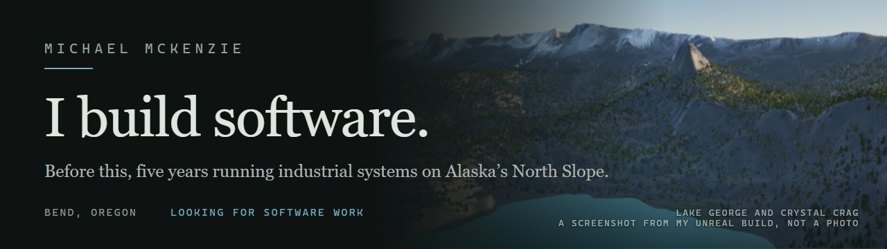

I build software in Bend, Oregon. I taught myself, shipped an iPhone app through Apple review on my own, and run a news site that's live right now. Before software I ran and fixed equipment on Alaska's North Slope.

**[See the work →](https://michael-mckenzie-portfolio.vercel.app)**

### What I've built

| | |
|---|---|
| **[Rabbit Hole](https://apps.apple.com/us/app/rabbit-hole/id6759622269)** | iPhone app, on the App Store since March 2026. Take a photo of something you see every day and it tells you what's actually interesting about it. |
| **[Darkwire](https://darkwire.vercel.app/)** | Live news site. Pulls from a set of news sites, merges copies of the same story, and puts the top stories on one page. |
| **MMTHWRLD** | The Mammoth Lakes country I grew up in, rebuilt from real elevation data in Unreal Engine 5.8. Twin Lakes first. Private, still building. |
| **[SourceCheck](https://github.com/tmsrecording-cyber/sourcecheck)** | Early version. Chrome extension that checks claims in a YouTube video while it plays, and can mark a claim as unverified when the evidence is too thin. Code is public. |

### What I build with

React Native · TypeScript · Node.js · Next.js · Python · Unreal Engine 5.8

Most of my work lives in private repos. The portfolio has the screenshots and the whole story.

📫 tmsrecording@gmail.com
